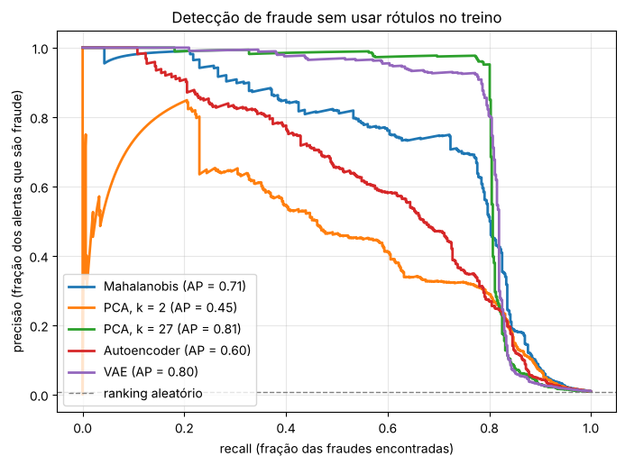
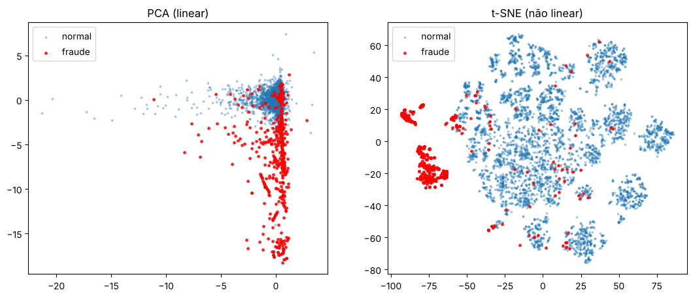

# Detecção de fraude com PCA, autoencoder e VAE

PCA, autoencoder e VAE implementados do zero em PyTorch e usados para detectar fraudes em cartão de crédito **sem usar os rótulos no treino**: os modelos aprendem só com transações normais, e uma transação mal reconstruída é suspeita.



## Resultados

Teste com 57.355 transações, das quais 492 (0,86%) são fraude.

| Método                  | Precisão média (AP) | Fraudes no top 100 |
|-------------------------|---------------------|--------------------|
| Ranking aleatório       | 0,009               | ~1                 |
| PCA, 2 componentes      | 0,45                | 82                 |
| Autoencoder (latente 8) | 0,60                | 91                 |
| Mahalanobis             | 0,71                | 99                 |
| VAE (latente 8)         | 0,80                | 100                |

## Visualização
As fraudes (em vermelho) vistas pela PCA e pelo t-SNE, numa amostra com as 492 fraudes e 5.000 transações normais:



Uma parte das fraudes forma ilhas próprias no t-SNE, mas outra parte fica no meio das transações normais.

## O que aprendi
- As colunas `V1` a `V28` do dataset já são componentes principais, então fazer PCA nelas é fazer "PCA em cima de PCA": depois de padronizar, quase todos os autovalores dão exatamente 1.
- A fraude aparece nas direções de **menor** variância das transações normais. A PCA com poucas componentes descarta justamente essas direções; a distância de Mahalanobis dá mais peso a elas.
- O VAE foi bem melhor que o autoencoder comum, e isso se manteve com outras sementes.
- Cerca de 20% das fraudes se parecem com transações normais em todos os métodos (a curva despenca perto de 80% de recall).

## Arquivos
- `fraude_pca_autoencoder_vae.ipynb`: PCA, autoencoder linear, t-SNE e a detecção de fraude
- `vae_mnist.ipynb`: VAE no MNIST, com geração de dígitos e o espaço latente

## Como rodar
```
pip install numpy pandas torch torchvision scikit-learn matplotlib
```
Baixe o `creditcard.csv` no [Kaggle](https://www.kaggle.com/datasets/mlg-ulb/creditcardfraud) (~150 MB, grande demais para o GitHub) e coloque na mesma pasta dos notebooks. O MNIST é baixado automaticamente.

## Referências
- Murphy, K. P. *Probabilistic Machine Learning: An Introduction*. MIT Press, 2022. Cap. 20.
- Dataset: Machine Learning Group (ULB), [Credit Card Fraud Detection](https://www.kaggle.com/datasets/mlg-ulb/creditcardfraud).
